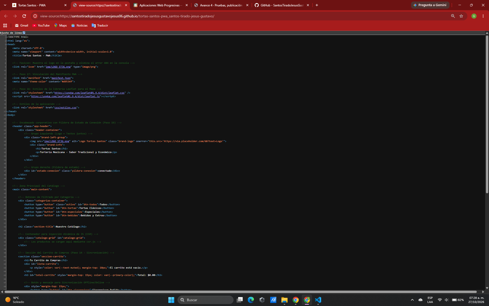
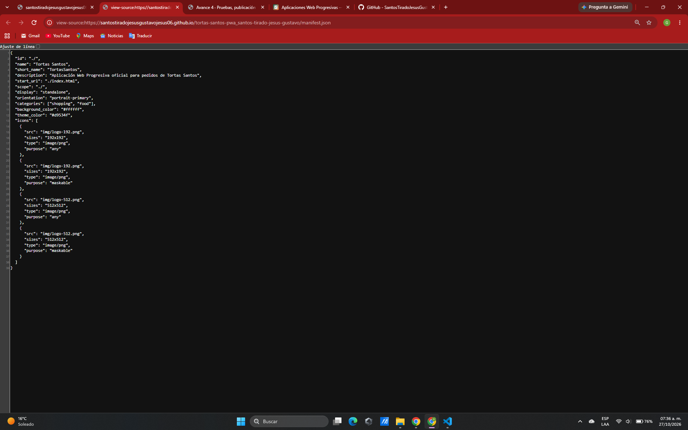
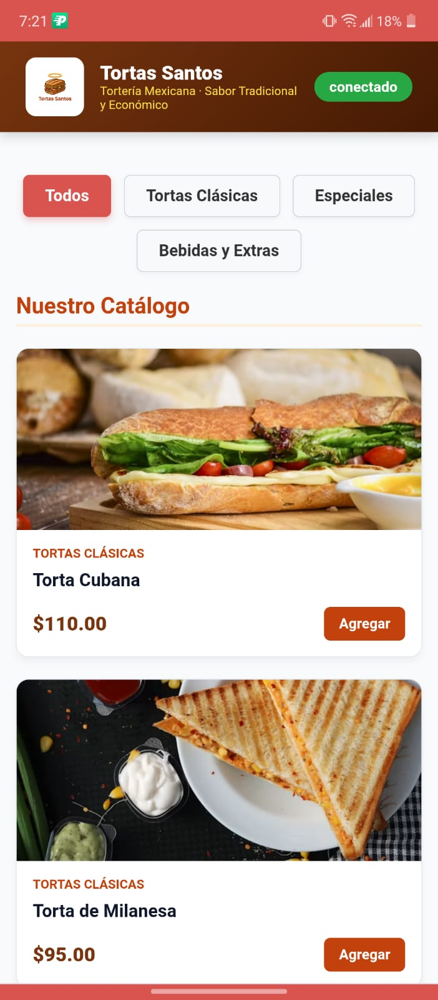

# Tortas Santos — PWA de ventas
 
| Dato | Valor |
|---|---|
| **Alumno** | SANTOS TIRADO JESUS GUSTAVO |
| **Grupo** | ING10-1 |
| **Negocio · giro** | Tortas Santos · Tortería |
| **URL del repositorio** | https://github.com/SantosTiradoJesusGustavoJesus06/tortas-santos-pwa_santos-tirado-jesus-gustavo |
| **URL de GitHub Pages** | https://santostiradojesusgustavojesus06.github.io/tortas-santos-pwa_santos-tirado-jesus-gustavo/ |

---

## Descripción del Proyecto
Aplicación Web Progresiva (PWA) desarrollada para la tortería **Tortas Santos**. Permite a los clientes consultar el catálogo completo de productos, bebidas y complementos, realizar pedidos en línea y acceder a información clave del establecimiento desde dispositivos móviles y de escritorio.

---

## Historial de avances

| Avance | Hash del commit entregado | Fecha |
|---|---|---|
| 1 | `6a6f295` | 06/10/2026 |
| 2 | `08fe65c` | 15/10/2026 |
| 3 | `cd22623` | 22/10/2026 |
| 4 | `caffbc7` | 29/10/2026 |
---


## Estructura del Proyecto (Avance 1)

```text
tortas-santos-pwa_santos-tirado-jesus-gustavo/
├── index.html          # App Shell base y contenedor del catálogo (CSR)
├── catalogo.json       # Datos de los 15 productos en formato JSON
├── README.md           # Documentación principal del proyecto
├── css/
│   └── estilos.css     # Estilos responsivos con paleta de color propia
├── js/
│   ├── csr.js          # Renderizado del lado del cliente (CSR) usando fetch()
│   └── carrito.js      # Lógica del carrito, filtros y persistencia con localStorage
└── docs/               # Capturas de pantalla requeridas por la rúbrica
    ├── captura-ssr.png
    └── captura-csr.png

```

---

## Estructura y Arquitectura (Avance 2)

**🌮 Tortas Santos - Catálogo (SSR vs CSR)**  
**Alumno:** Santos Tirado Jesus Gustavo  

## Comparación SSR vs CSR

### SSR (Django): los productos llegan escritos en el HTML


### CSR (JavaScript): el div del catálogo llega vacío


## Funciones PWA (avance 3)

### index.html: manifest y registro del Service Worker activos


### sw.js: Workbox precachea el catálogo y las fotos


## Versión publicada (avance 4)

### index.html en GitHub Pages


### manifest.json en GitHub Pages


### Mi app instalada en el celular


## Guía de Instalación y Uso — Tortas Santos PWA

### Requisitos previos
- Dispositivo móvil (Android con Chrome o iOS con Safari) o computadora con navegador moderno.
- Conexión a internet para la primera carga.

### Pasos para instalar en Celular (Android / Chrome)
1. Abre el navegador Chrome e ingresa a la URL: `https://santostiradojesusgustavojesus06.github.io/tortas-santos-pwa_santos-tirado-jesus-gustavo/`
2. Despliega el menú de opciones (tres puntos superiores).
3. Selecciona **"Instalar aplicación"** o **"Agregar a la pantalla principal"**.
4. Confirma la instalación. El ícono de **Tortas Santos** aparecerá en tu menú de aplicaciones.

### Pasos para instalar en Celular (iPhone / Safari)
1. Abre Safari e ingresa a la URL del proyecto.
2. Toca el botón de **Compartir** (cuadro con flecha hacia arriba).
3. Selecciona la opción **"Agregar al inicio"**.

### Uso Offline
Una vez instalada, la app cacheará el catálogo y los recursos mediante el Service Worker generado con Workbox. Podrás abrirla directamente desde el ícono en tu pantalla de inicio incluso sin conexión a internet.