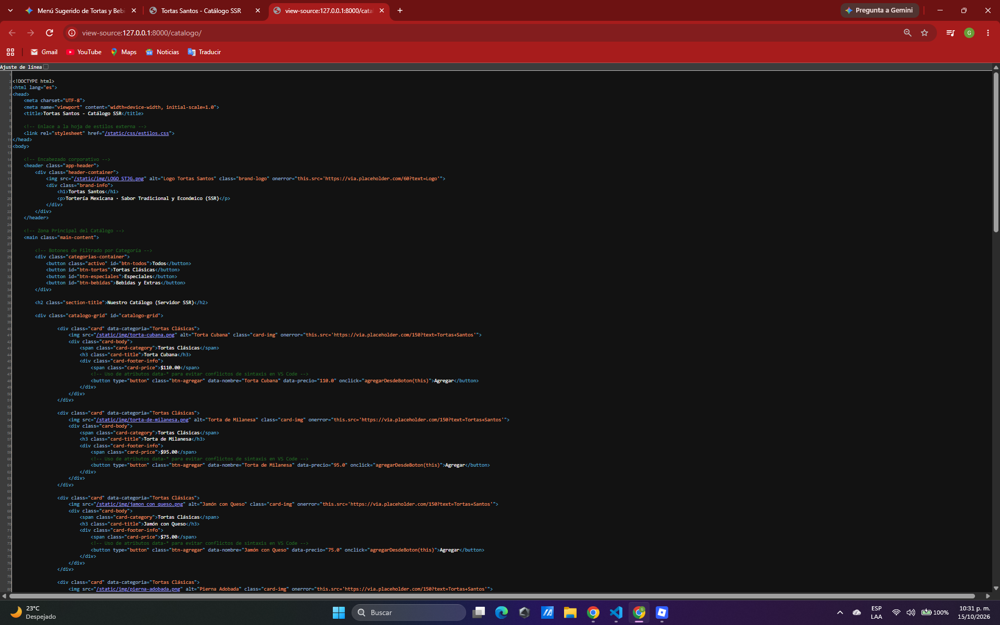
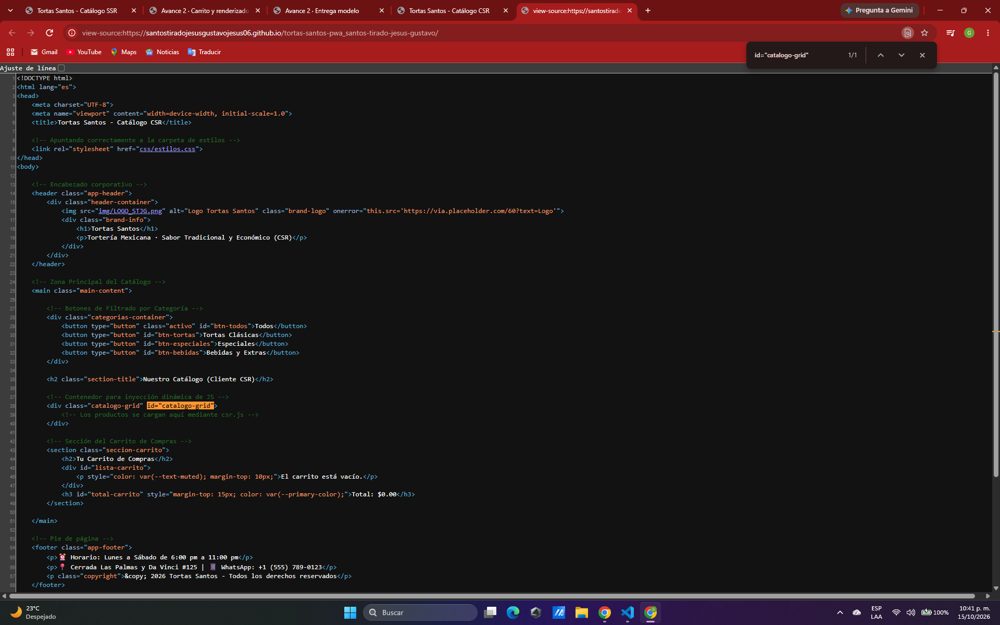

# Proyecto PWA - Tortas Santos

**Nombre del estudiante:** Santos Tirado Jesús Gustavo  
**Grupo:** TDSM10-1  
**Negocio:** Tortas Santos  
**Giro:** Tortería Mexicana (Alimentos y Bebidas)  

- **URL del repositorio:** [GitHub Repository](https://github.com/SantosTiradoJesusGustavoJesus06/tortas-santos-pwa_santos-tirado-jesus-gustavo)
- **URL de GitHub Pages:** [GitHub Pages](https://santostiradojesusgustavojesus06.github.io/tortas-santos-pwa_santos-tirado-jesus-gustavo/)

---

## Descripción del Proyecto
Aplicación Web Progresiva (PWA) desarrollada para la tortería **Tortas Santos**. Permite a los clientes consultar el catálogo completo de productos, bebidas y complementos, realizar pedidos en línea y acceder a información clave del establecimiento desde dispositivos móviles y de escritorio.

---

## Historial de Avances

| Avance | Descripción | Fecha / Estado |
| :--- | :--- | :--- |
| 1 | Estructura base, diseño responsivo y recursos estáticos. | 11/10/2026 |
| 2 | Catálogo de 15 productos, carrito interactivo y comparativa SSR vs CSR. | 18/10/2026 |
| 3 | Próxima implementación de características PWA (Service Workers / Offline). | 25/10/2026 |
| 4 | (Se escribe en el reporte PDF) | 01/11/2026 |

---

## Estructura del Proyecto (Avance 1)

```text
tortas-santos-pwa_santos-tirado-jesus-gustavo/
├── index.html          # App Shell base y contenedor del catálogo (CSR)
├── catalogo.json       # Datos de los 15 productos en formato JSON
├── README.md           # Documentación principal del proyecto
├── css/
│   └── estilos.css     # Estilos responsivos con paleta de color propia
├── js/
│   └── csr.js          # Renderizado del lado del cliente (CSR) usando fetch()
└── img/                # Imágenes de productos (<= 300 KB) y logo
```

---

## Estructura y Arquitectura (Avance 2)

**🌮 Tortas Santos - Catálogo (SSR vs CSR)**  
**Alumno:** Santos Tirado Jesus Gustavo  

### 🔍 Comparativa de Código Fuente: SSR vs CSR

#### 1. SSR (Server-Side Rendering — Django)
Los productos vienen completamente inyectados e iterados desde el servidor en el HTML inicial:

```html
<div class="catalogo-grid" id="catalogo-grid">
    <div class="card" data-categoria="Tortas Clásicas">
        <h3 class="card-title">Torta Cubana</h3>
        <span class="card-price">$110.00</span>
    </div>
    <!-- ... más productos renderizados por el servidor ... -->
</div>
```
*<div class="catalogo-grid" id="catalogo-grid">
    
        <div class="card" data-categoria="{{ producto.categoria }}">
            
            <div class="card-body">
                <span class="card-category">{{ producto.categoria }}</span>
                <h3 class="card-title">{{ producto.nombre }}</h3>
                <div class="card-footer-info">
                    <span class="card-price">${{ producto.precio|floatformat:2 }}</span>
                    <button type="button" class="btn-agregar" data-nombre="{{ producto.nombre }}" data-precio="{{ producto.precio }}" onclick="agregarDesdeBoton(this)">Agregar</button>
                </div>
            </div>
        </div>
    
        <p>No hay productos disponibles en este momento.</p>
    
</div>*

#### 2. CSR (Client-Side Rendering — JavaScript)
El contenedor llega vacío desde el servidor y JavaScript inyecta los elementos en tiempo de ejecución:

```html
<div class="catalogo-grid" id="catalogo-grid">
    <!-- El contenedor llega vacío; JavaScript poblará las tarjetas dinámicamente -->
</div>
```

## Comparación SSR vs CSR

### SSR (Django): los productos llegan escritos en el HTML


### CSR (JavaScript): el div del catálogo llega vacío
