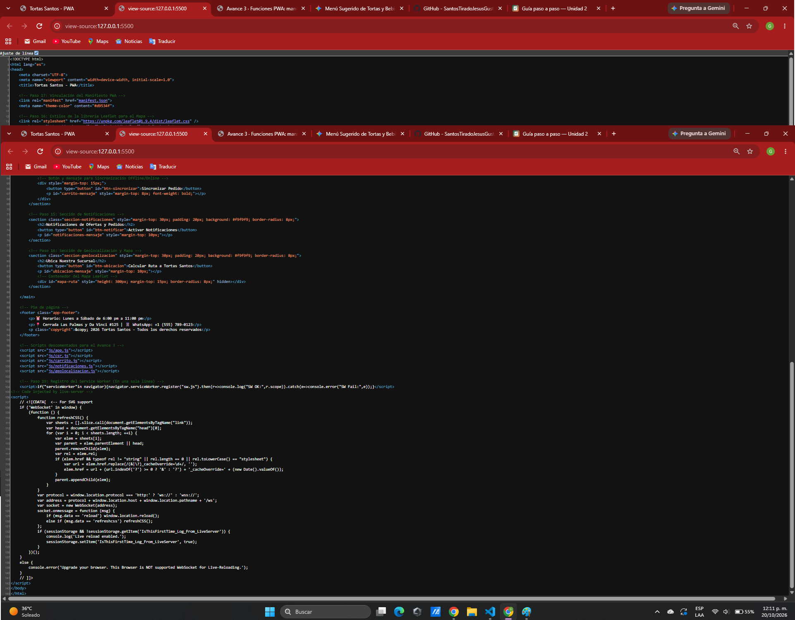
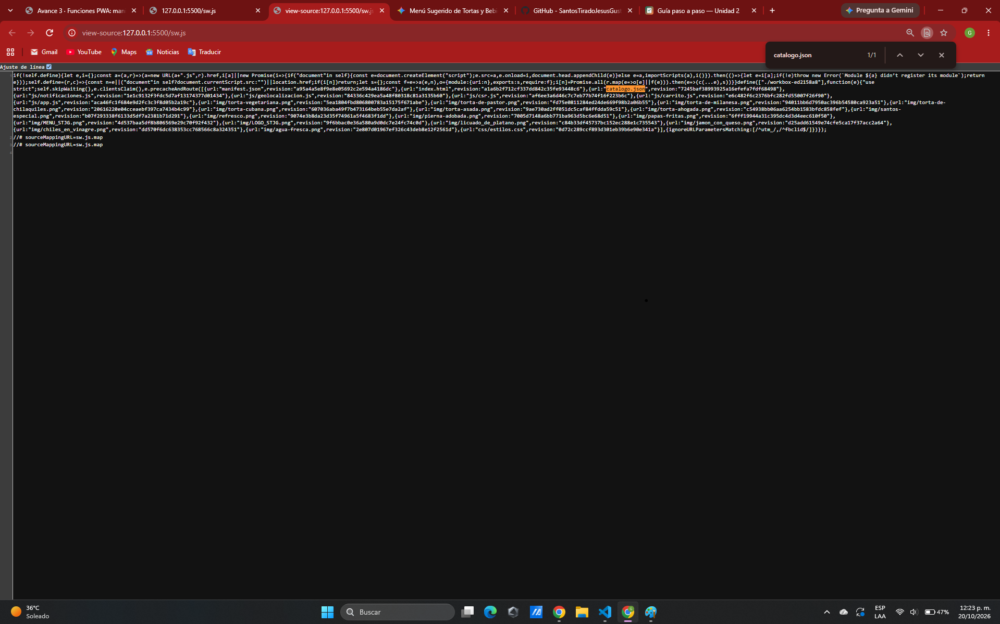

# Tortas Santos — PWA de ventas
 
| Dato | Valor |
|---|---|
| **Alumno** | SANTOS TIRADO JESUS GUSTAVO |
| **Grupo** | ING10-1 |
| **Negocio · giro** | Tortas Santos · Tortería |
| **URL del repositorio** | https://github.com/SantosTiradoJesusGustavoJesus06/tortas-santos-pwa_santos-tirado-jesus-gustavo |
| **URL de GitHub Pages** | https://santostiradojesusgustavojesus06.github.io/tortas-santos-pwa_santos-tirado-jesus-gustavo/ |

---

## Descripción del Proyecto
Aplicación Web Progresiva (PWA) desarrollada para la tortería **Tortas Santos**. Permite a los clientes consultar el catálogo completo de productos, bebidas y complementos, realizar pedidos en línea y acceder a información clave del establecimiento desde dispositivos móviles y de escritorio.

---

## Historial de avances

| Avance | Hash del commit entregado | Fecha |
|---|---|---|
| 1 | `6a6f295` | 06/10/2026 |
| 2 | `08fe65c` | 15/10/2026 |
| 3 | `cd22623` | 22/10/2026 |
| 4 | (se escribe en el reporte PDF) | — |
---


## Estructura del Proyecto (Avance 1)

```text
tortas-santos-pwa_santos-tirado-jesus-gustavo/
├── index.html          # App Shell base y contenedor del catálogo (CSR)
├── catalogo.json       # Datos de los 15 productos en formato JSON
├── README.md           # Documentación principal del proyecto
├── css/
│   └── estilos.css     # Estilos responsivos con paleta de color propia
├── js/
│   ├── csr.js          # Renderizado del lado del cliente (CSR) usando fetch()
│   └── carrito.js      # Lógica del carrito, filtros y persistencia con localStorage
└── docs/               # Capturas de pantalla requeridas por la rúbrica
    ├── captura-ssr.png
    └── captura-csr.png

```

---

## Estructura y Arquitectura (Avance 2)

**🌮 Tortas Santos - Catálogo (SSR vs CSR)**  
**Alumno:** Santos Tirado Jesus Gustavo  

## Comparación SSR vs CSR

### SSR (Django): los productos llegan escritos en el HTML


### CSR (JavaScript): el div del catálogo llega vacío


## Funciones PWA (avance 3)

### index.html: manifest y registro del Service Worker activos


### sw.js: Workbox precachea el catálogo y las fotos
